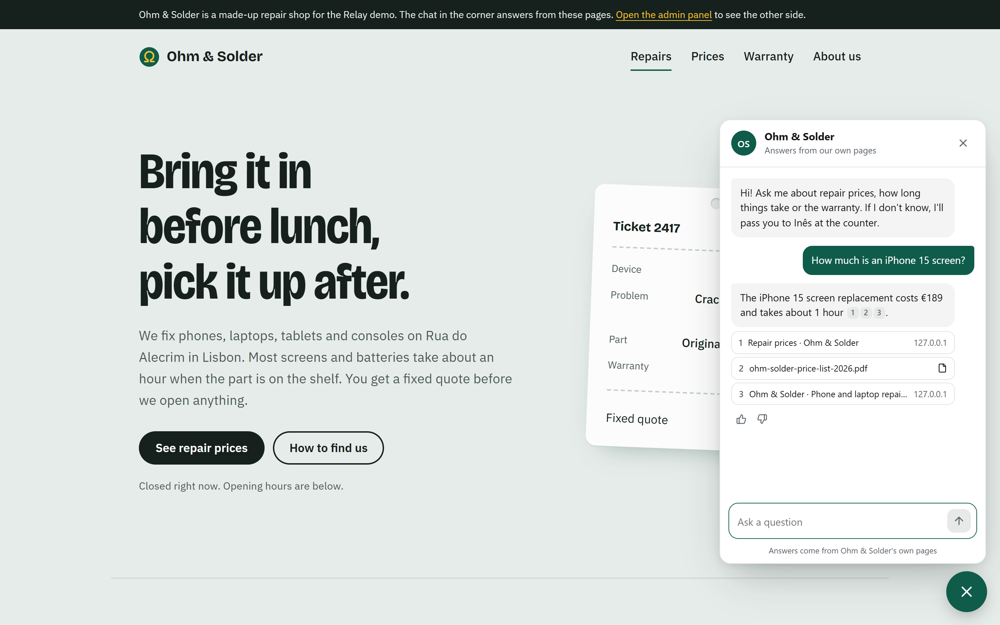
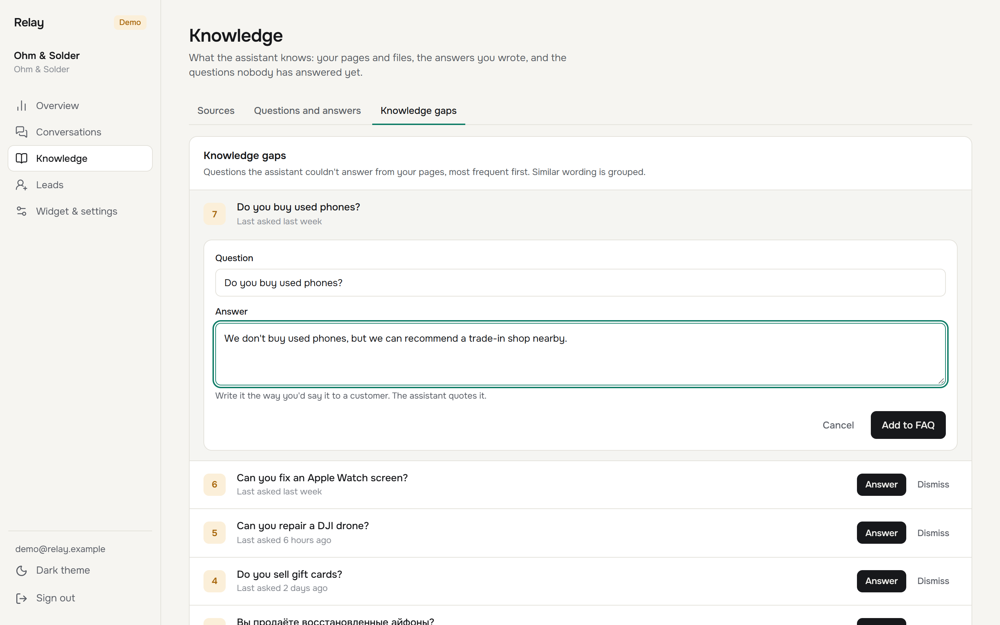
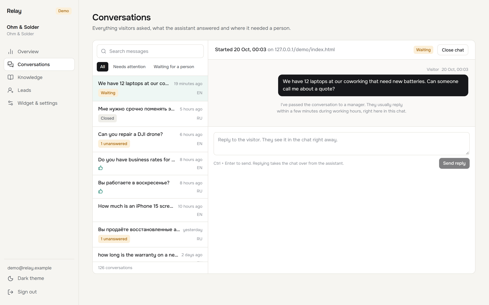
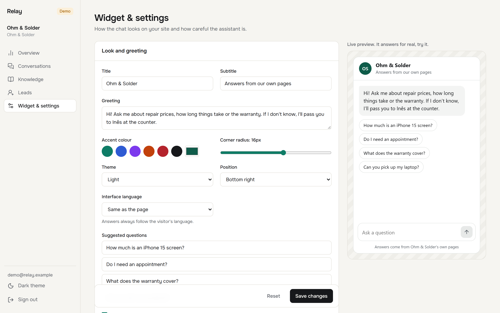
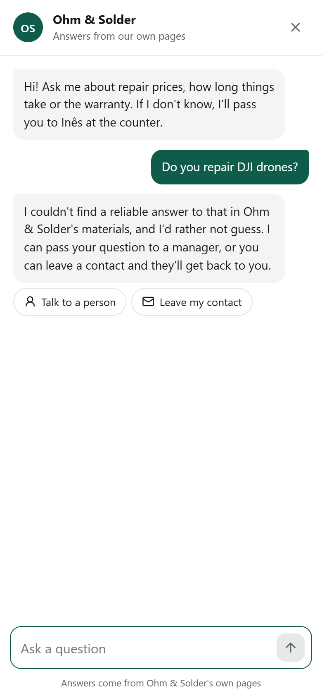

# Relay: a website assistant that answers from your own pages

Relay is a chat widget you add to any site with one `<script>` tag. It answers visitors from the company's own material (site pages, PDFs, documents, hand-written Q&A). When the material doesn't cover a question, it says so and offers a person in Telegram or a contact form instead of making something up.



## What it does

**For visitors**

- Streams answers in the visitor's language, with numbered citations that link to the source page.
- Starts with suggested questions, so nobody stares at an empty box.
- Below a confidence threshold, answers "I don't know" and offers two ways out: talk to a person or leave a contact.
- Hands the chat to a manager. The manager replies from Telegram (or the admin panel) and the reply appears in the same widget, live.
- Works on phones as a full-screen sheet, follows the page language, supports light and dark themes, keyboard and screen readers.

**For the site owner**

- Knowledge sources: crawl a sitemap or a single page, upload PDF, DOCX, TXT or HTML, write Q&A pairs. Each source shows its indexing status.
- Knowledge gaps: questions the assistant couldn't answer, grouped by meaning and sorted by how often people ask. Answer one and it becomes a FAQ entry the assistant uses right away.
- Conversations inbox with sources and confidence for every answer, flags on suspected prompt injection, and a reply box that takes the chat over from the bot.
- Overview: conversations per day, share solved without a person (confirmed by a thumbs-up vs. no complaints), handoffs, leads, token spend against the monthly budget.
- Widget settings with a live preview, the embed snippet and a one-click Telegram connect link.
- Several sites in one installation. Each has its own key, allowed domains, budget and threshold.

| Knowledge gaps | Conversations |
|---|---|
|  |  |

| Settings with live preview | Phone |
|---|---|
|  |  |

## Try it locally

You need Docker. Everything else runs in containers.

```bash
git clone https://github.com/manch1915/site-ai-assistant.git
cd site-ai-assistant
docker compose up --build
```

The first start downloads the embedding model (about 470 MB) and seeds a demo. Then open:

- http://localhost:8088/demo/ for Ohm & Solder, a made-up phone repair shop with the widget on every page;
- http://localhost:8088/admin/ and press **Open the demo workspace**.

Without an LLM key the assistant runs in **quote mode**: it replies with the lines from your pages that answer the question and links the source. To get written answers, put any OpenAI-compatible endpoint into `.env` (see `.env.example`) and restart:

```bash
cp .env.example .env   # set LLM_API_KEY, optionally LLM_BASE_URL and LLM_MODEL
docker compose up -d
```

## Add it to a site

```html
<script src="https://your-relay-host/widget.js" data-key="pk_your_site_key" async></script>
```

The loader is 1.5 kB gzipped. It draws the launcher button and fetches the chat itself (16 kB gzipped) only when the visitor hovers or taps it, so the host page's Lighthouse score doesn't pay for a chat nobody opened. The widget lives in a Shadow DOM and can't break the site's styles. Requests are accepted only from the domains listed for that key.

## How it works

```
 site page ── widget.js ─┐                          ┌─ Telegram group (managers)
                         ▼                          │
 admin (Next.js) ──► FastAPI ──► PostgreSQL + pgvector     ▲
                         │  └──► Redis: rate limits, queue, live events
                         ▼
                    SAQ worker: crawling, parsing, embeddings, Telegram messages
```

A question goes through two searches over the site's chunks: cosine similarity in pgvector (HNSW index) and Postgres full-text search with prefix matching, merged with Reciprocal Rank Fusion. Confidence is the best similarity rescaled to 0..1 and reduced when the passages miss the question's key words, which is what catches "can you fix my washing machine?" on a phone repair site. Below the site's threshold the model is never called. Above it, the model gets the passages as numbered, untrusted data, must cite them and must reply `NO_ANSWER` when they don't contain the answer. That reply is caught in the stream before the visitor sees anything and turns into the same "I don't know" branch. Every model call is counted against the site's monthly budget and a global daily cap; when either runs out, answers fall back to quotes.

The code follows a plain layered layout. `domain/` holds pure logic (chunking, scoring, prompt building, injection checks), `services/` the use cases (indexing, chat, handoff, analytics), `infra/` the adapters (database, embeddings, LLM client, crawler, Redis), and `api/` the HTTP layer. Dependencies are wired in one container object, so tests swap the embedder, the model and the notifier for fakes.

### Confidence threshold

`python -m app.cli calibrate` runs 37 questions against the demo shop: 25 that its pages answer (in English and Russian) and 12 that they don't, including off-topic and on-topic-but-missing ones. With the default threshold of 0.35, 35 of 37 land on the right side. The two misses are short Russian questions to an English knowledge base; for a bilingual audience, add content in both languages.

### Prompt injection

There is no single fix, so it's handled in layers: retrieved text is passed as data inside tags, the bot has no tools or side effects, anything outside the knowledge base ends in the "don't know" branch, and a pattern check flags messages like "ignore previous instructions" in English and Russian. Flagged messages still get an answer but the model is reminded to stay on task, and the admin shows a flag on that message.

## Stack

- **API:** Python 3.12, FastAPI, SQLAlchemy 2 (async), Alembic, PostgreSQL 17 with pgvector, Redis, SAQ for background jobs, aiogram 3 for Telegram.
- **Embeddings:** `intfloat/multilingual-e5-small` through fastembed on CPU by default; any OpenAI-compatible embeddings endpoint as an option.
- **Answers:** any OpenAI-compatible chat API (OpenAI, OpenRouter, a self-hosted gateway), streamed over SSE.
- **Widget:** Preact, TypeScript, Vite library builds, Shadow DOM, no runtime dependencies besides Preact.
- **Admin:** Next.js 16 (App Router), React 19, TanStack Query, Tailwind CSS 4.
- **Ops:** Docker Compose, Caddy, GitHub Actions.

## Development

Start Postgres and Redis, then run each app on its own:

```bash
docker compose up -d db redis

cd apps/api
uv sync --all-extras
uv run alembic upgrade head
uv run python -m app.cli seed
uv run fastapi dev --port 8011        # API, demo shop at /demo/
uv run saq app.worker.settings        # background jobs (separate terminal)

cd apps/widget && npm ci && npm run build   # copies the bundles into apps/api/static
cd apps/admin && npm ci && npm run dev      # http://localhost:3010/admin
```

Checks, the same ones CI runs:

```bash
cd apps/api && uv run ruff check src tests && uv run mypy && uv run pytest
cd apps/widget && npm run lint && npm test && npm run size
cd apps/admin && npm run lint && npm run build && npm run typecheck
```

API tests run against a real Postgres with pgvector and use a hashing embedder and a scripted model, so they need no network and no keys.

## Configuration

All settings come from environment variables; `.env.example` lists them with defaults.

| Variable | What it does |
|---|---|
| `LLM_BASE_URL`, `LLM_API_KEY`, `LLM_MODEL` | OpenAI-compatible chat endpoint. Empty key means quote mode. |
| `EMBEDDINGS_PROVIDER` | `local` (fastembed) or `openai` with `EMBEDDINGS_BASE_URL` and `EMBEDDINGS_API_KEY`. |
| `DAILY_TOKEN_LIMIT` | Hard daily cap across all sites. Each site also has a monthly budget in the admin. |
| `WIDGET_RATE_PER_MINUTE` | Messages per minute per visitor IP and site. |
| `TELEGRAM_BOT_TOKEN`, `TELEGRAM_BOT_USERNAME` | Enables handoff to Telegram. Managers add the bot to a group with the link from Settings. |
| `OWNER_EMAIL`, `OWNER_PASSWORD`, `OWNER_SITE_KEY` | Creates a real (non-demo) workspace on first start. |
| `PUBLIC_URL` | Public address of the installation, used in links and CORS. |

## Deployment

`docker-compose.yml` runs the whole stack behind a small Caddy proxy on one origin: `/admin` goes to Next.js, everything else to the API. On a server with an existing Caddy, drop the `proxy` service and add a site block like the one in [`deploy/Caddyfile.example`](deploy/Caddyfile.example). Keep `flush_interval -1` on the API route, otherwise streamed answers arrive in one piece. The public demo account can't crawl other sites, change bot instructions, domains or budget, and the demo workspace is rebuilt every six hours.
